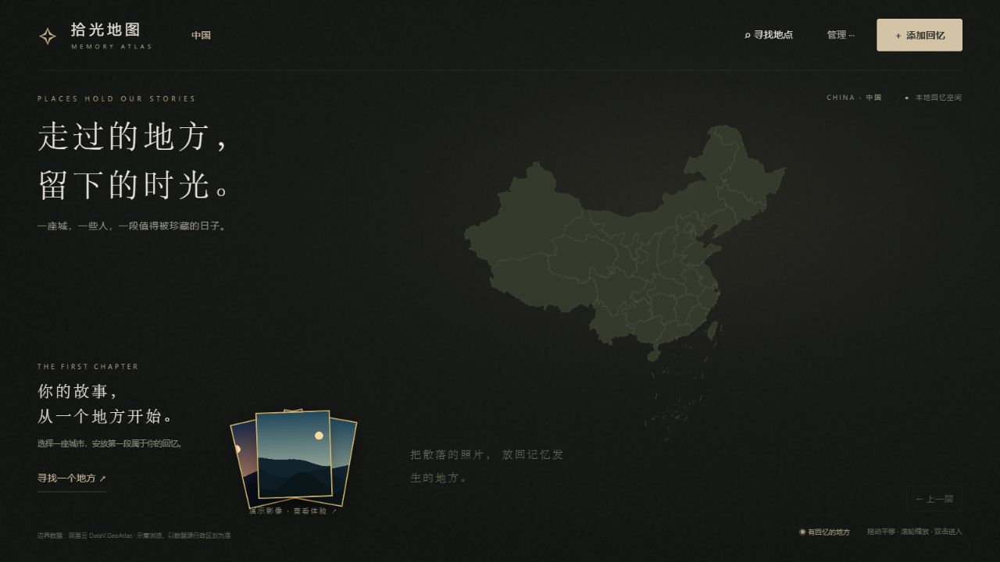
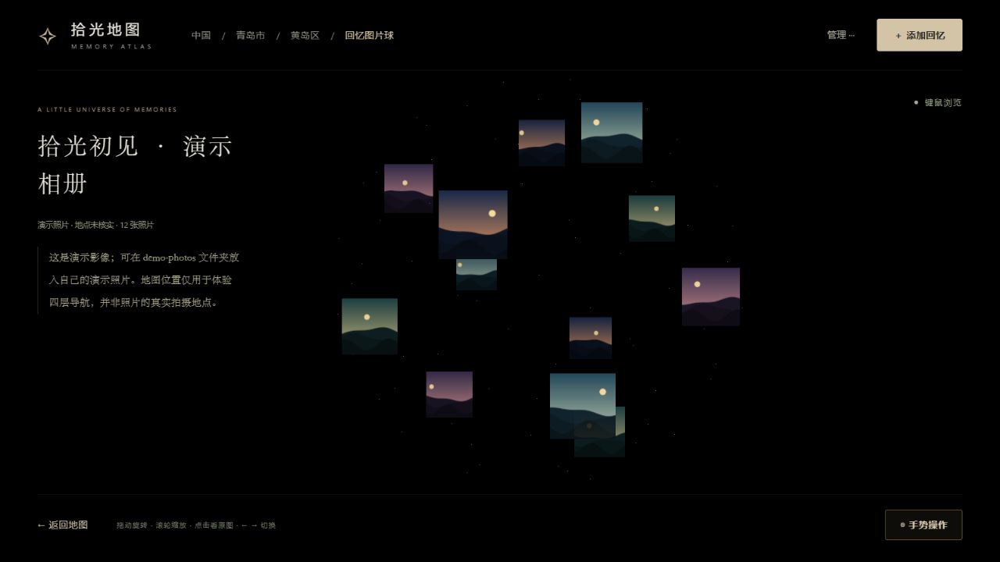

# 拾光地图 · Memory Atlas

把回忆留在走过的地方。一个面向 Windows 和 Mac 电脑的本地影像项目，通过 **中国地图 → 地级市 → 区县 → 回忆图片球** 浏览照片与故事。支持键鼠操作，图片球还支持摄像头手势。

照片、缩略图、日期、文字和地点保存在自己电脑上的 `回忆库` 文件夹。项目无需云端账户或远程数据库。





## 下载与启动

### 普通用户：下载完整包

在仓库右侧 **Releases** 选择对应电脑的完整包：

| 电脑 | 下载文件 | 解压后启动 |
| --- | --- | --- |
| Windows 10/11 x64 | `memory-atlas-windows-x64.zip` | 双击 `start.bat` |
| Apple 芯片 Mac（M 系列） | `memory-atlas-macos-arm64.zip` | 双击 `Start-Memory-Atlas.command` |
| Intel Mac | `memory-atlas-macos-x64.zip` | 双击 `Start-Memory-Atlas.command` |

**完整解压 ZIP** 到一个自己可以写入的文件夹，再启动。Mac 可在苹果菜单 →“关于本机”查看“芯片”或“处理器”。不要在 ZIP 预览窗口中运行，不要只复制启动文件。

完整包包含对应架构的 Python 便携环境、地图数据、Three.js、MediaPipe、手部模型及 12 张程序生成的演示风景插画。**无需安装 Python、Node.js、npm，也无需联网下载前端依赖。**

Mac 启动器是未签名的命令脚本，完整包尚未进行 Apple Developer ID 签名或公证。如果 macOS 拦截首次打开，请核对来源、校验文件，按照 [Apple 官方指引](https://support.apple.com/zh-cn/102445) 在“系统设置 → 隐私与安全性”中处理自己信任的下载。项目不会自动删除下载隔离标记或关闭系统保护。也可在终端中进入解压目录运行 `bash start-macos.sh`；该方式同样遵循系统对运行环境的安全检查。

### 开发者：克隆或下载源码

1. 点击 **Code → Download ZIP** 并解压，或者使用 `git clone` 克隆本仓库。
2. Windows 双击 `start.bat`；Mac 双击 `Start-Memory-Atlas.command`，或在终端运行 `bash start-macos.sh`。
3. 如果没有可用的 Python 3.10+，首次会从 **python.org 官方来源下载约 11 MB 的 Python 3.13.12 x64 便携环境**，校验 SHA-256 后放在项目的 `runtime/python` 下。首次准备需要联网。
   Mac 源码版会在缺少项目私有环境时，从 Astral 的 python-build-standalone 官方项目下载固定版本、对应架构的 CPython 并校验 SHA-256，保存到 `runtime/macos-arm64` 或 `runtime/macos-x64`。不调用 Apple 的开发工具安装占位程序，也不需要 Homebrew、Xcode 或管理员权限。
4. 后续启动直接复用已有环境。源码已包含 `vendor` 及地图资源，正常使用不需要互联网。

首次联网准备失败时可以重新运行，或改用完整包。启动器不修改 PATH、不需要管理员权限、不依赖 Codex。已安装可用 Python 的电脑可以直接使用其环境。

## 适用环境

- Windows 10/11 x64；或 macOS 12 及以上的 Apple 芯片 / Intel Mac。Mac 原生自动化验收使用 macOS 15 运行器，较旧系统仍建议自行确认兼容性。
- 使用近期版本的 Microsoft Edge 或 Google Chrome；需启用 WebGL。
- 键鼠浏览无需摄像头。手势功能需要摄像头，第一次点击“手势操作”时由浏览器询问授权。
- 服务仅监听 `127.0.0.1`，不作为局域网或互联网服务器。
- 启动窗口会显示实际地址，默认 `http://127.0.0.1:8000/index.html`，端口占用时会使用 8000—8010 中可用端口。
- 浏览器地址保持本机 HTTP 地址，不要直接双击 `index.html`。
- Mac 首次启动会自动生成照片清单，重复启动会复用同一项目的本地服务；诊断日志位于 `runtime/logs`。

## 怎么使用

1. **全国**：点击省份筛选城市，或通过“寻找地点”搜索城市。单击城市后点击进入按钮，也可双击城市。
2. **城市**：选中或双击下辖区县进入。
3. **区县**：点击地图内部选择回忆位置，点击“添加回忆”，填写标题、地点、日期、文字并选择照片。也可使用区县默认中心点。
4. **图片球**：默认缓慢自转。拖动旋转、滚轮缩放、点击照片展开；展开后左右方向键切换照片，Esc 关闭照片。普通球体视图按 Esc 返回地图。

鼠标悬停照片、拖动、打开对话框或查看原图时，键鼠模式的自动旋转暂停，结束交互后恢复。地图使用滚轮缩放和拖动平移。回忆标记采用暖金色光尘涟漪。

“管理”菜单提供备份、恢复、删除功能。选中个人回忆后可删除，相册会移入本地回忆库的回收站；删除不影响最初导入的源文件。

## 图片球手势

点击“手势操作”，摄像头及模型准备好后进入。此时应用内键鼠输入暂停，**只保留 Esc 退出手势模式**。退出后关闭摄像头、恢复键鼠，本次 Esc 不会同时关闭照片或退回地图。

按摄像头画面左右区分双手：

| 左手 | 右手 | 效果 |
| --- | --- | --- |
| ① | 向右横扫 | 快速旋转 |
| ② | 握拳 / 张掌 | 聚拢 / 散开 |
| ③ | 捏合并移动 | 准星选照片 |
| ③ | 选中后稳定张掌 | 展开照片 |
| ③ | 再次稳定捏合 | 返回图片球 |

摄像头帧在电脑本地识别。模型和 WASM 直接从本地文件加载。真实识别效果还受光线、遮挡、摄像头和设备性能影响。

## 个人资料与备份

每个用户首次运行时会自动创建自己的文件夹：

```text
回忆库/
├─ library.json
├─ albums/
│  └─ 相册编号/
│     ├─ album.json
│     ├─ originals/
│     └─ thumbnails/
└─ 回收站/
```

- 复制整个 `回忆库` 即可备份；也可在“管理”中导出 JSON 备份，通过“恢复备份”导入。
- 更新程序时，将新版解压到新文件夹，再复制旧版的 `回忆库` 到新版目录。建议先保留一份独立备份。
- 删除或清理浏览器数据不会删除此文件夹。
- 每个人使用独立的本地资料，下载源码不会获得开发者的私人相册。

## 演示素材

默认使用 `sample-photos` 的 12 张程序生成风景插画，允许随本项目分发。它们不是实拍照片，演示地点只用于体验四层导航，不代表真实拍摄地点。演示不计入个人回忆和备份。

需要换演示素材时，把 JPG、JPEG、PNG 或 WebP 图片直接放进 `demo-photos`，重新运行对应系统启动器，再强制刷新浏览器（Windows：Ctrl+F5；Mac：Command+Shift+R）。仅扫描这一层文件夹，不扫描子文件夹。有自定义演示照片时优先使用它们，否则回退到内置插画。

`回忆库`、`demo-photos`、测试截图和本机配置已列入 `.gitignore`；打包脚本还使用白名单排除这些内容。

## 常见问题

- **双击后报错**：保留启动窗口中的错误。确认完整解压、路径可写；首次下载失败检查联网，或使用完整包。
- **照片球空白**：按 Ctrl+F5 刷新，确认 `vendor/three` 和 `sample-photos` 等目录都在。浏览器需支持 WebGL。
- **无法打开摄像头**：使用 Edge/Chrome，在浏览器站点权限中允许摄像头，检查其他程序是否占用设备。页面必须通过 `start.bat` 打开的本机服务访问。
- **模型加载失败**：确认 `vendor/mediapipe/wasm` 和 `vendor/models/hand_landmarker.task` 存在；重新完整解压。维护者可运行下面的依赖修复命令。
- **关闭启动窗口后还能访问**：本机服务在后台运行，启动窗口关闭不会停止它。再次运行启动器会复用本项目已运行的服务。
- **Windows 拦截运行**：发行包没有代码签名。请核对下载来源和发布的 SHA-256；不要将关闭系统安全保护作为安装步骤。

## 开发、验证与打包

本项目没有 npm 构建步骤。维护者需要 Python 3.10+；运行 JavaScript 回归测试另需 Node.js。

```powershell
# 修复/重新准备固定版本浏览器资源，校验下载 SHA-256
python scripts/prepare-release.py --dependencies

# 重新生成内置演示插画（不改自定义照片）
python scripts/generate-samples.py

# 制作包含便携 Python 的完整 ZIP
python scripts/prepare-release.py
```

Mac 维护者可运行 `python3 scripts/build-macos.py --arch arm64` 或 `--arch x64` 构建对应包，运行 `python3 tests/test_macos_portable.py --arch arm64`（或 x64）做原生 ZIP 验收。打包保留 Unix 可执行权限和运行环境符号链接。

仓库的 `Build and validate desktop releases` Actions 工作流分别使用 Apple 芯片 Mac、Intel Mac 和 Windows 运行器；三种原生构建与测试全部成功后才发布 Release。它覆盖完整包换目录启动及 Mac 源码首次下载启动，不包括 Finder 的 Gatekeeper 弹窗与真人摄像头体验。

Windows 维护者也可以双击 `build-release.bat`。产物为 `dist/memory-atlas-windows-x64.zip` 和对应的 `.sha256`，可作为 GitHub Release 附件。该命令不创建仓库、不上传任何文件。包内只有白名单文件，使用独立演示清单，不包含当前电脑的回忆库、自定义演示照片、测试截图或 Codex 配置。

```powershell
node tests/review-regressions.cjs
node tests/performance-regressions.cjs
node tests/gesture-stability.cjs
node tests/launcher-regressions.cjs
python tests/test_local_library.py
python tests/test_distribution.py
python tests/test_macos.py

# 换目录及无系统 Python 的启动检查（会启动独立测试服务）
python tests/test_portable_smoke.py
python tests/test_portable_smoke.py --source
```

浏览器回归必须使用独立临时回忆库，例如 `python serve.py --port 8011 --library "C:\Temp\拾光测试库"`，再打开 `/tests/atlas-browser.html`。不要对个人资料库运行数据写入测试。自动化模拟不代替真人摄像头手感、干净 Windows 电脑或系统安全拦截验收。

## 数据与许可证

自编代码和内置演示插画使用 MIT 许可证。第三方库、Python、模型及地图数据各自遵循其适用条款，详见 `THIRD_PARTY_NOTICES.md`。地图来自阿里云 DataV.GeoAtlas 的 2026-10-27 快照；原始文件未附明确的再分发许可证，维护者正式公开分发前仍需确认适用条款。项目许可证不替地图或用户照片重新授权。

地图是行政区边界示意，不是导航地图。源数据缺少下辖区县的区域使用现有边界回退。Three.js、MediaPipe 与模型版本固定，下载地址和校验值保存在 `resources.lock.json`，更新依赖时应重新验证功能。
